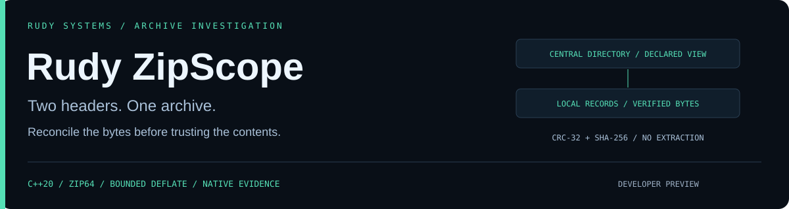
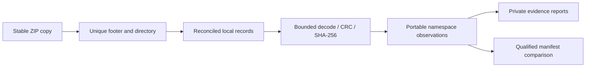

<p align="center"></p>

<p align="center">
<a href="https://github.com/r4venrudy/rudy-zipscope/actions/workflows/ci.yml"></a>

<a href="LICENSE"></a>
<a href="https://rudy.systems"></a>
</p>

**A ZIP file names the same entry in two places. Those names can disagree. So can sizes, record boundaries, Unicode alternatives and the destination paths an extractor would see.**

Rudy ZipScope is a native C++20 archive investigation and regression tool. It reconciles central and local ZIP metadata, verifies stored/raw-DEFLATE contents with CRC-32 and SHA-256, models a conservative portable namespace, and compares qualified decoded manifests. It does not extract members, follow archive links, contact services or execute payloads.

Developer preview · ZIP64 and streaming descriptors · bounded inflation · private-by-default reports · JSON / text / SARIF / local RUDY HTML · native Linux, Windows and macOS packages.

## Investigate without extraction

Download a [native release](https://github.com/r4venrudy/rudy-zipscope/releases), verify `SHA256SUMS.txt`, extract the package, then use `bin/zipscope` or `bin\zipscope.exe`:

```sh
bin/zipscope inspect examples/synthetic/stored.zip
bin/zipscope inspect examples/synthetic/local-disagreement.zip --format html --output investigation.html
bin/zipscope inspect examples/synthetic/traversal.zip --format sarif --output review.sarif
bin/zipscope compare examples/synthetic/stored.zip examples/synthetic/deflated.zip
bin/zipscope compare examples/synthetic/stored.zip examples/synthetic/changed.zip
```

The header-disagreement and traversal examples return `1`. Recompression alone retains the same qualified manifest and returns `0`; a changed payload returns `1`. Corrupt, unsupported, ambiguous or over-budget input returns `2` and cannot pass a comparison even with `--fail-on none`.

| Investigation | Evidence |
| --- | --- |
| Do readers see one coherent archive? | Exact-ending EOCD selection, ZIP64 sentinel reconciliation, central/local flags and sizes, four descriptor layouts |
| Does each payload match its claims? | Exact compressed range, raw-DEFLATE termination, expanded length, CRC-32 and decoded SHA-256 |
| Can entries alias or escape a portable namespace? | Both raw name views, CRC-qualified Unicode alternatives, parent/absolute/drive/stream names, ASCII-case collisions, file ancestors and Windows device names |
| Do links change the meaning of a destination? | Unix symlink attributes, bounded target text, parent/absolute target observations, link reachability/cycles; no links created |
| Are bytes hidden outside referenced records? | Non-overlap checks and hashed unreferenced ranges, including prefixes; those bytes are identified, not executed or declared malicious |
| Did a release's decoded contents change? | Added/removed/modified exact-name manifest entries; decoded hashes, sizes, external attributes and creator host |

These are **documented profile observations**, not a universal extractor simulation or proof that a particular product is exploitable. Full CP437, Unicode normalization/case folding, arbitrary metadata conventions, mount behavior and extractor-specific quirks are outside scope. Non-ASCII names receive an explicit portability warning. [Profile and limits](docs/PROFILE.md).

## Trust the qualified result



`complete: true` means the supported structural/content profile finished. Findings may still reject a policy gate. `complete: false` retains available evidence and a stable stop code/offset; unvisited or failed entries remain unverified. A qualified comparison requires both profiles to finish, every payload verified, unique names and no error-level namespace findings. Otherwise `comparable` is false and `manifestEqual` is null.

The comparison projection intentionally excludes compression representation, timestamps, comments and unrelated extra metadata. Whole-source SHA-256 still distinguishes different archive bytes. It is not a complete ZIP metadata equivalence claim. [Design](docs/DESIGN.md) · [Native integration](docs/INTEGRATION.md).

## Build and verify

CMake 3.20+, a C++20 compiler and a native build tool are required. Python 3.9+ standard library supports independent tests and packaging. Both C/C++ dependencies are bundled, pinned and licensed; building or running the core needs no package registry or network fetch.

```sh
cmake -S . -B build -DCMAKE_BUILD_TYPE=Release -DZIPSCOPE_REQUIRE_CLI_TESTS=ON
cmake --build build --config Release --parallel 2
ctest --test-dir build -C Release --output-on-failure
cmake --install build --config Release --prefix stage
python examples/make_archives.py artifacts/synthetic
python benchmarks/measure.py stage/bin/zipscope
```

Use `stage/bin/zipscope.exe` on Windows. CI exercises native Windows, Linux and macOS builds, plus a Linux ASan/UBSan build. The independent Python oracle covers the invented corpus and **384 generated archives**, including stored, compressed, streaming and local ZIP64 forms. It independently checks decoded bytes, CRC-qualified results, name/source hashes, offsets and attributes. Native tests include every truncation of a representative archive, **2,048 deterministic mutations**, SHA standard vectors and a 2,000-link graph. [Validation scope](docs/VALIDATION.md) · [Measured benchmark methodology](benchmarks/README.md).

`zipscope_embed` demonstrates the C++ API on an in-memory empty ZIP. The parser/model is C++; bundled zlib C code provides raw-DEFLATE and CRC-32, and nlohmann/json serializes evidence. [Dependency provenance](THIRD_PARTY.md).

## Gates, limits and disclosure

| Contract | Default / supported range |
| --- | --- |
| Input | 256 MiB / `--max-input-mib 1..1024` |
| Decoded bytes per entry | 64 MiB / `--max-entry-mib 0..1024` |
| Decoded bytes per archive | 512 MiB / `--max-total-mib 0..2048` |
| Entries | 10,000 / `--max-entries 1..100000` |
| Each raw name | 4 KiB; UTF-8 or unflagged ASCII |
| Retained decoded content | Only symlink targets, up to 4 KiB each |
| Namespace component work | One million modeled component/ancestor steps |
| Reports | 16 MiB; new-file-only creation |

Inspection defaults to `--fail-on warning`; `error` ignores warnings and `none` records findings without hitting a completed-profile gate. Comparison defaults to `--fail-on changed`; `none` ignores qualified manifest changes. Neither bypasses an incomplete analysis. Exit codes: `0` gate clear, `1` gate hit, `2` input/usage/I/O/incomplete result.

Names and link-target/payload bytes stay out of reports by default. `--show-names` reveals name values or exact raw hex for invalid encodings; payload bytes remain absent. Digests and sizes can still identify data. Source recordings/ZIP fixtures are not anonymized by hashing a report.

`--output NEW_FILE` uses exclusive creation: existing files, including source/report aliases, are preserved. POSIX requests mode `0600`; Windows inherits destination permissions. An I/O failure can leave a partial newly created report. Opened source bytes are rechecked after analysis; this is not an atomic or hostile-writer snapshot guarantee.

Encrypted archives, split disks, unsupported compression, patched/strong-encryption flags and ambiguous footer/descriptor interpretations produce incomplete results. ZIP signatures authenticate nothing by themselves; no malware classifier, signature trust service or extraction sandbox is implemented.

[Security](SECURITY.md) · [Contributing](CONTRIBUTING.md) · [Release validation](docs/RELEASE.md) · [Rudy Systems](https://rudy.systems)
